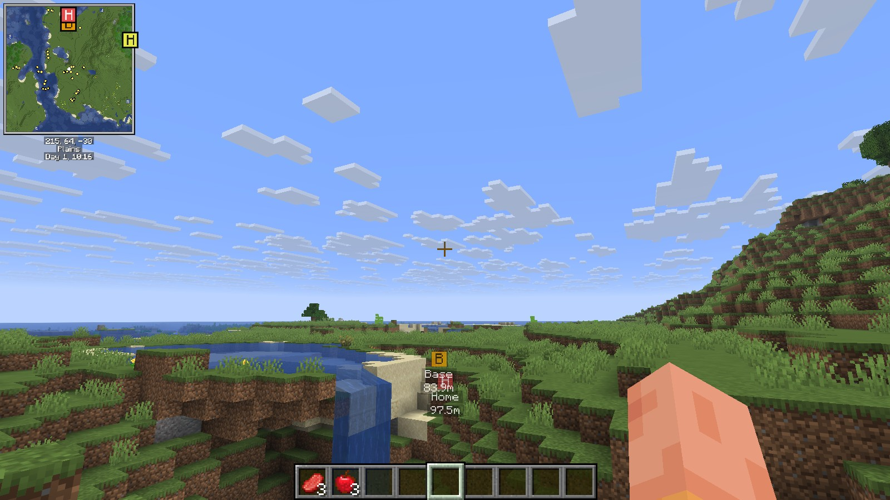
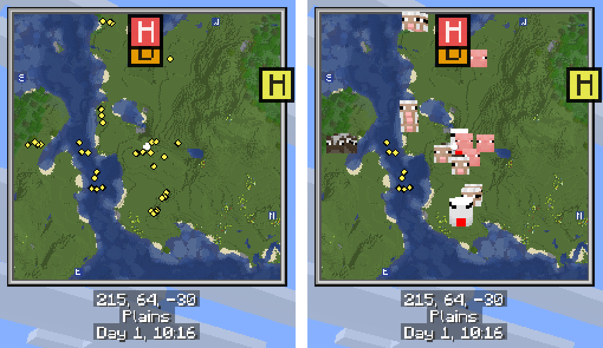
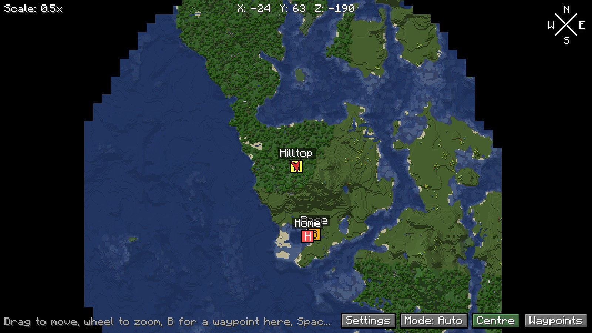
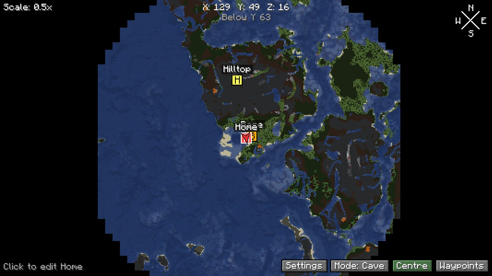
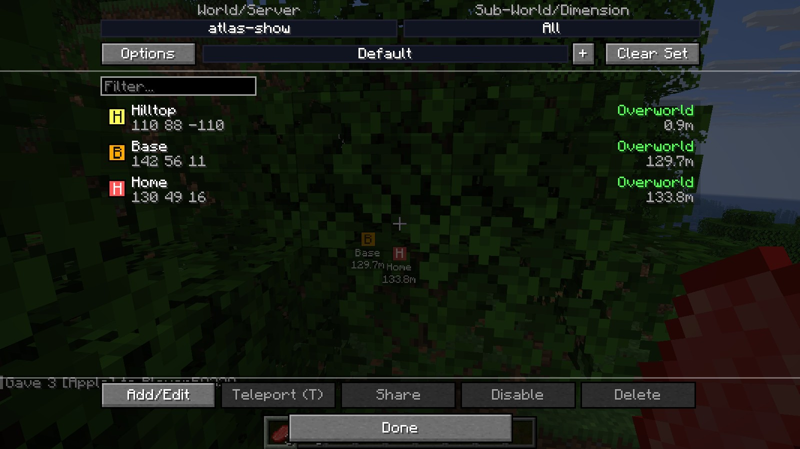
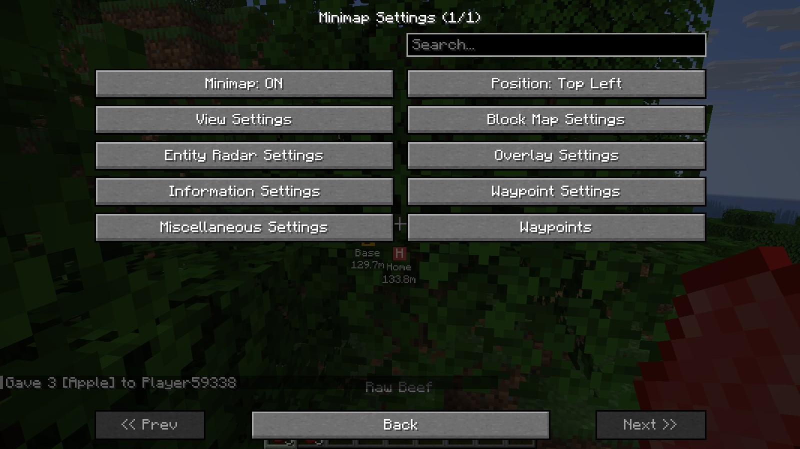
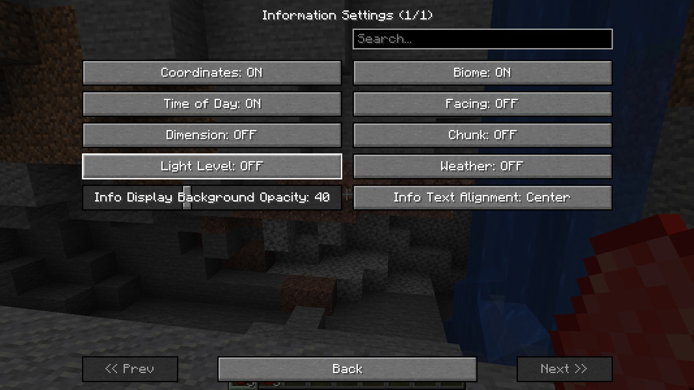

# Atlas for Horizon

**A sharp minimap, a world map of everywhere you've been, and waypoints on both.**
A native mod for [Horizon](https://github.com/horizon-rust/horizon) (Minecraft 26.3), in the style of Xaero's Minimap and
World Map.



## Minimap

Drawn at your screen's own resolution, so every block is crisp. It scrolls smoothly, turns with you (or locks north),
and scales with your window. Height steps are drawn as fine contour lines, so cliffs and hills read at a glance.

Entities show as diamonds: yellow mobs, white players, red dropped items, purple everything else, fading the further
they are above or below you. **Hold Tab** for mob faces, player faces and item icons.

<p align="center"></p>

## World map

Press **M**. It shows everything you have explored, saved per world, server and dimension. Drag to move, scroll to
zoom, and press **B** over any spot to make a waypoint there. The dimension button shows another dimension's map
from wherever you are (the Nether's centred where you would be there), and the pointer's line gives the same spot's
Nether or Overworld coordinates.



### Map modes

Both maps share three modes, and each keeps its own saved map:

- **Auto**: the surface in the open, the cave around you underground, under a roof and in the Nether
- **Cave**: always a cross-section around you
- **Layer**: a cut at any height you choose



## Waypoints

**B** makes one where you stand, **H** a temporary one. They show on both maps and in the world, as a small square
with their letter and name, and their distance while you look at them.

**U** opens the waypoint screen: sets, a filter, and Add/Edit, Teleport (T, for operators), Share, Enable/Disable and
Delete, and Disable All / Enable All for the whole set. Dying leaves a deathpoint, which goes away when you reach it.
With **Overworld Waypoints in Nether** on, Overworld waypoints show in the Nether at an eighth of their coordinates,
and ones made in the Nether are saved as the Overworld's.



## Settings

**Y** opens the settings: over 90 options on pages, with a search across them all.

| | |
|---|---|
|  |  |

- **View**: size, shape, zoom, opacity, lighting, frame style and colour, enlarged minimap (hold **Z**)
- **Block map**: colour mode, cave mode, slopes, transparency, grass, flowers, leaves
- **Entity radar**: categories, dot size, icons, names, height limit, depth fade, player cross or arrow
- **Overlays**: chunk grid, light overlay, slime chunks, portal highlights (chunks with Nether portals, End portals
  or gateways), the server's view distance
- **Information**: coordinates, biome, time, facing, dimension, chunk, light and weather lines
- **Waypoints**: scales, opacity, render distance, deathpoints, compass

`/atlas <setting> <value>` in chat sets any of them exactly, and `/atlas help` lists them:

```
/atlas size 30           minimap side, percent of the window's height
/atlas zoom 2            blocks per minimap pixel
/atlas mode layer 40     auto | cave | layer [height]
/atlas seed <seed>       this world's seed, for slime chunks (a server never sends it)
```

## Keys

| Key | Does |
|---|---|
| **M** | World map |
| **B** | New waypoint (under the pointer on the world map) |
| **U** | Waypoint screen |
| **H** | Temporary waypoint |
| **Y** | Settings |
| **Z** | Enlarged minimap |
| **[** and **]** | Zoom the minimap |
| **Tab** | Faces and icons on the minimap |

All but Tab can be changed in Options > Mods > Atlas.

## Install

Download `atlas-0.2.0.hnmod` from [Releases](https://github.com/MrCloudy2/horizon-atlas/releases), add it to your native
mods in the Horizon launcher, and build. Atlas is pinned to Horizon Nightly 2026-11-05 (`f319701`), because it reads the
game's world directly, so a newer Nightly may need a new release. Turn off Horizon's own Minimap so you don't get two.

Everything Atlas keeps is in `horizon-mods/.horizon-mod-data/atlas/` in the game folder: `settings.txt`, waypoints and
seeds per world and server, and the maps in `maps/<world>/<dimension>/<layer>/`.

## Credits

- Based on [Waypoints](https://github.com/Nirokx/horizon-waypoints) by Nirokx (MIT)
- The map columns follow Horizon's minimap (MIT)
- Portal highlights, dimension switching, the view distance square, Overworld waypoints in the Nether and Disable
  All come from [XaeroPlus](https://github.com/rfresh2/XaeroPlus) by rfresh2 (MIT), written anew for Atlas
- The look follows Xaero's Minimap and World Map. Atlas is its own code, with no code or art from them, and isn't
  affiliated with them.

Licence: MIT.

## Build from source

Uses the Horizon launcher's own Rust and Horizon source:

```sh
L=~/.local/share/horizon-launcher
export PATH=$L/rust/1.99.1-x86_64-unknown-linux-gnu/bin:$PATH CARGO_HOME=$L/cargo
cargo test --offline                      # the mod's logic
tools/check.sh                            # applies the bundle to Horizon and type-checks the game
python3 tools/package.py --install        # makes target/atlas-0.2.0.hnmod and installs it in the launcher
tools/build-game.sh && tools/play.sh      # an Atlas-only game, offscreen, for testing; drive it with tools/ctl.sh
```

- `mixins/atlas/core.rs`: all the logic, std only, with its tests
- `mixins/atlas/bridge.rs`: the game side: chunk scans, map images, entities, drawing
- `mixins/atlas/*.rs`: one small adapter per hook point
- `mixins/atlas/horizon-mixin.toml`: where each hook goes
